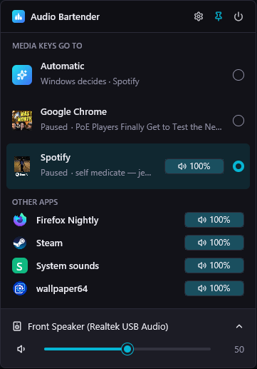

<div align="center">

<a href="https://araxeus.github.io/Audio-Bartender/">
  <picture>
    <source media="(prefers-color-scheme: dark)" srcset="assets/logo/lockup-horizontal-white.svg">
    
  </picture>
</a>

<p><b>The volume mixer Windows was missing.</b><br>
Per-app volume, live meters, media controls, and media keys that go to the app you choose.</p>

[](https://araxeus.github.io/Audio-Bartender/)
[](https://github.com/Araxeus/Audio-Bartender/releases/latest/download/AudioBartender-setup.exe)

<a href="https://araxeus.github.io/Audio-Bartender/"></a>

<sub>The live demo runs the real app in your browser, over a simulated taskbar.<br>
<a href="https://araxeus.github.io/Audio-Bartender/"><b>araxeus.github.io/Audio-Bartender</b></a></sub>

[](https://github.com/Araxeus/Audio-Bartender/releases/latest)
[](LICENSE)

</div>

## Features

- **Media keys go where you want.** Pick Spotify, and play/pause hits Spotify even while a YouTube tab is open.
- **Per-app volume** with live level meters, right from the tray.
- **Per-app output device.** Music on headphones, the game on speakers.
- **Now playing** with album art and play, pause, next and previous.
- **Scroll the tray icon** to change the volume. Middle-click to mute.
- **Tray icons that move with the music,** or a plain speaker if you prefer.
- **Replaces the Windows speaker** on the Windows 11 taskbar (optional).
- **Light, dark and 14 accent colors.** Hide any part of the flyout you don't use.
- **Updates itself** and checks each download against its SHA-256 digest.

## Download

| File | What |
|---|---|
| [`AudioBartender-setup.exe`](https://github.com/Araxeus/Audio-Bartender/releases/latest/download/AudioBartender-setup.exe) | Installer. Lets you pick Native or Web, and all users or just you |
| [`AudioBartender-portable.exe`](https://github.com/Araxeus/Audio-Bartender/releases/latest/download/AudioBartender-portable.exe) | Native, no install |
| [`AudioBartender-web-portable.exe`](https://github.com/Araxeus/Audio-Bartender/releases/latest/download/AudioBartender-web-portable.exe) | Web, no install |

Silent install flags are `/VERYSILENT`, `/ALLUSERS` or `/CURRENTUSER`, `/INTERFACE=native|web` and `/TASKS="startup"`.

## Native or Web?

Both look and work the same. They share one core and one settings file, so you can switch any time. Pick Native unless the download size matters most.

| | Native (GPUI) | Web (Tauri) |
|---|---|---|
| Portable exe | 9.2 MB | **3.4 MB** |
| Start, closed to open | **240 ms** | 445 ms |
| Reopen from the tray | 90 ms | **32 ms** |
| Reopen after 60 s idle | **77 ms** | 416 ms |
| RAM in the tray | 17 MB | **12 MB** |
| RAM with the flyout open | **24 MB** | 135–160 MB |
| Processes with the flyout open | **1** | 7 |
| Draws with | DirectX 11 | Edge WebView2 |
| Needs | Nothing | WebView2 Runtime (built into Windows 11) |

<sub>Measured with <code>scripts/measure.ps1</code> on Windows 10 22H2. Web frees its webview after 60 s closed, so the next open rebuilds it. Reopen times include launching the exe again, which opens the running copy. RAM is the private working set of the whole process tree.</sub>

## Tips

- **Pick where media keys go** by clicking an app in the flyout. Automatic leaves Windows in charge.
- **Send an app to another device** by right-clicking its row.
- **Pin the flyout** to keep it open, then drag it by its header.
- **Hide the Windows volume icon** on Windows 11 with the Windhawk mod [Taskbar tray system icon tweaks](https://windhawk.net/mods/taskbar-tray-system-icon-tweaks), then turn on *Settings → Use Windows speaker position*.
- **Start with Windows** from Settings. Installing for all users also lets media keys work while an admin window has focus.

## Build

```powershell
pwsh build.ps1   # both front ends and the installer, into dist/
```

See [docs/DEVELOPMENT.md](docs/DEVELOPMENT.md) for the layout, measurements, the website demo and Windows quirks.

## License

[MIT](LICENSE)
